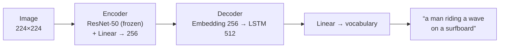

<div align="center">

# 🖼️ Image Captioning

**A CNN–RNN model that looks at a photo and writes a sentence describing it**

<p>
  
  
  
  
</p>

</div>

---

## 📌 Overview

This project combines computer vision and natural language processing: a pretrained **ResNet-50** encoder turns an image into a feature vector, and an **LSTM** decoder generates a caption word by word. The model is trained on the Microsoft **COCO** dataset.

## 🖼️ Results

Example captions generated on test images:


| Metric | Value |
|---|---|
| Final training loss | ≈ 2.2 (cross-entropy) |
| Final perplexity | ≈ 8.8 |
| Training | 3 epochs over ~414k caption–image pairs, batch size 128 |

## 🧠 Architecture



| Setting | Value |
|---|---|
| Encoder | ResNet-50 pretrained on ImageNet, final layer replaced by a 256-d embedding |
| Decoder | Word embedding (256) → single-layer LSTM (hidden size 512) → linear layer over the vocabulary |
| Vocabulary | Words appearing at least 5 times in the training captions |
| Augmentation | Resize 256 → random crop 224, horizontal flip, ImageNet normalization |
| Optimizer | Adam (lr = 1e-4) on the decoder and the encoder's embedding layer |
| Inference | Greedy sampling, one word at a time until `<end>` |

## 🗂️ Dataset

[Microsoft COCO 2014](https://cocodataset.org/): over 80,000 training images, each with 5 human-written captions.

## 📂 Repository structure

```
├── 0_Dataset.ipynb        # exploring COCO images and captions
├── 1_Preliminaries.ipynb  # data loader, vocabulary and model sanity checks
├── 2_Training.ipynb       # training the encoder–decoder
├── 3_Inference.ipynb      # generating captions for new images
├── data_loader.py         # COCO data loader with caption-length batching
├── vocabulary.py          # builds and stores the word ↔ index vocabulary
├── vocab.pkl              # saved vocabulary
├── model.py               # EncoderCNN and DecoderRNN
└── README.md
```

## 🚀 Getting started

```bash
# 1. Clone the repository
git clone https://github.com/hamidghasemi69/Image-Captioning.git
cd Image-Captioning

# 2. (Recommended) create a virtual environment
python -m venv .venv && source .venv/bin/activate
pip install torch torchvision nltk pycocotools matplotlib jupyter

# 3. Launch the notebook
jupyter notebook
```

Download the [COCO 2014](https://cocodataset.org/#download) images and annotations, then run the notebooks in order (0 → 3).

## 🙏 Acknowledgements

- Project from the **Udacity** Computer Vision Nanodegree
- Vinyals et al., [*Show and Tell: A Neural Image Caption Generator*](https://arxiv.org/abs/1411.4555) (2015)
- [Microsoft COCO](https://cocodataset.org/) dataset

## 👤 Author

**Hamidreza Ghasemi** · Principal Data Scientist @ Arizona State University

[](https://hamidghasemi69.github.io)
[](https://www.linkedin.com/in/hamidghasemi69/)
[](https://github.com/hamidghasemi69)

<sub>If you find this project useful, consider giving it a ⭐</sub>
